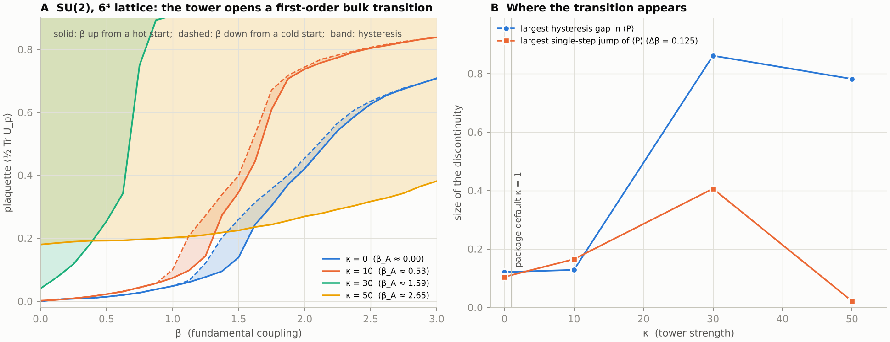

# CC-69 — the character repair adopted: the MTFT plaquette action and what follows (2026-10-17)

`mtft.research.repaired_action`, `tests/test_repaired_action.py`; every number reproducible from `report()`.

## The action

CC-35 (2026-09-29) retracted reflection positivity for the Polyakov power-sum tower and named its repair. The repair is adopted: the
programme's lattice action puts the arithmetic tower on genuine characters, on plaquettes,

    s(U_p) = beta (1 - Re Tr U_p / N) + (kappa / N) sum_{n >= 2} a_n(y) (d_n - Re chi_{Sym^n}(U_p)),     a_n = w_n e^{-2 pi y n}, w_1 = 0,

with d_n = dim Sym^n. The Polyakov power-sum form in `mtft.lattice.MTFTAction` is kept as the historical action (API stability).

## What is now a theorem (EXACT)

1. **Reflection positivity and the strong-coupling gap.** The weight e^{-s} is the exponential of a non-negative combination of characters,
   so it is a positive-type class function and every coefficient of f = sum d_rho c_rho chi_rho is non-negative (checked to 1e-16 on SU(2) and
   SU(3) for beta in {0, 2.5, 6}, kappa in {0, 1, 100, 1000}, representations to l1 = 8). The Osterwalder–Seiler argument then applies verbatim:
   link-reflection positivity, a positive transfer matrix, and for small character activity a mass gap and an area law from the cluster
   expansion. The repaired action therefore has a rigorous non-perturbative mass gap at strong coupling, exactly as Wilson's action has. Its
   position relative to the Clay problem is that of every reflection-positive lattice action: the continuum limit with a uniform gap is open.
2. **Centre symmetry.** Plaquettes are blind to the centre, so the plaquette action is exactly Z_N-symmetric and the Polyakov loop is an order
   parameter. Both Polyakov-line placements break it explicitly: V(z 1) - V(1) per site is 0.066 kappa (SU(3), power sums) and 0.176 kappa
   (SU(3), Sym^n). The original action had no confinement order parameter at any coupling, as QCD with dynamical quarks has none.
3. **N-ality.** Sym^n has N-ality n mod N, so the n-th arithmetic weight couples to the centre-vortex class of its index: a Z_N vortex — a
   2-sheet in four dimensions — linked once with a loop multiplies the Sym^n contribution by e^{2 pi i n / N}. In four dimensions a 1-cycle links a
   2-cycle (1 + 2 = 4 - 1), a knotted circle is always trivial and a 2-sphere can knot; the Wilson loop and the vortex sheet are the physical pair,
   and the 't Hooft loop that measures their linking exists as an order parameter only because item 2 holds. At kappa = 1 the SU(3) tower's
   weight a_n d_n / N splits 0.050 / 0.037 / 0.080 over the N-ality classes 0 / 1 / 2.

## What is computed (NUMERICAL; Weyl integration, SU(2) 4000 points, SU(3) 420 x 420, checked against character orthonormality and the Bessel
coefficients of the SU(2) Wilson action)

At strong coupling everything flows through u_f = c_f / c_0: sigma a^2 = -ln u_f and m(0++) a = -4 ln u_f at leading order (Münster 1981),
meaningful only deep in strong coupling.

| | u_f Wilson | u_f, kappa = 1 | shift | Wilson beta the tower is worth | activity sum d^2 u |
|---|---|---|---|---|---|
| SU(2), beta = 1.0 | 0.2402 | 0.2446 | +1.8% | beta_eff = 1.020 | 1.7 |
| SU(2), beta = 2.3 | 0.4793 | 0.4866 | +1.5% | 2.351 | 5.0 |
| SU(3), beta = 2.0 | 0.1286 | 0.1297 | +0.8% | 2.015 | 6.7 |
| SU(3), beta = 5.7 | 0.4027 | 0.4066 | +1.0% | 5.758 | 112 |

- The tower's plaquette couplings at kappa = 1 are (kappa/N) a_n = 0.012, 0.004, 0.002, ... (SU(3)). A 10% change of u_f at beta = 5.7 needs
  kappa = 9.3; kappa = 100 orders the plaquettes almost completely (u_f = 0.93, worth Delta beta = 56).
- The tower alone (beta = 0) gives u_f = 7 x 10^-5 at kappa = 1, scaling as kappa^2: a Sym^n character never contains the fundamental, Sym^2 x Sym^3 does.
- The lock y_c = 0.18174 plays no role: in the repaired action y only sets the decay of the couplings; no quantity of the gauge dynamics is
  stationary or singular there. C_3(y_c) = 0 remains an identity among the weights.
- The character activity is already of order one at beta = 1 (SU(2)) and 2 (SU(3)): the rigorous regime stops far short of the scaling window,
  as it does for every lattice action.
- Mixed actions with large higher-representation couplings have first-order bulk transitions (Bhanot–Creutz 1981); the location of that line
  for this action is not computed, so kappa cannot be taken large freely.
- DIAGNOSTIC `vortex_overlap`: the overlap of the plaquette weight with its centre-twisted copy falls from 0.98 (SU(3), beta = 0.5: vortices
  cost nothing) to 0.025 at beta = 5.7.

## Reading

The gap of the repaired action is Wilson's gap, corrected at the per-cent level by the arithmetic layer. The arithmetic does not supply a mass
gap; it decorates one that Osterwalder and Seiler proved for the plaquette term. Separately: "Hosotani Hessian positivity" (Matter-05, PG-6)
concerns the masses of compactification moduli, not the spectral gap of pure Yang–Mills on R^4; the first does not imply the second.

## Package changes

New `mtft.research.repaired_action` and `tests/test_repaired_action.py` (12 tests); Legend entry `cc69_repaired_action` (upstream
`cc35_reflection_positivity`); puzzle I.5 answered for the repaired action, open for the original; `mtft.lattice` docstring points here;
CC-35's register carries a dated addendum. Function names unchanged.

## The bulk transition (SU(2), Monte Carlo, 2026-10-17; NUMERICAL)

`scripts/cc69/bulk_mc_su2.py` (Metropolis, SU(2) quaternion links, 6^4 lattice, 300 sweeps per point, beta swept up from a hot start and down
from a cold start in steps of 0.125; data in `docs/SM/data/cc69_su2_bulk_k*.json`). The Sym^2 coupling in Bhanot–Creutz's convention is
beta_A = 3 kappa a_2 / 2 = 0.053 kappa, so their first-order region beta_A >~ 1.25 predicts a bulk transition for kappa >~ 25.

| kappa | beta_A | hot branch | cold branch | reading |
|---|---|---|---|---|
| 0 | 0 | crossover; branches within 0.12 of each other near beta = 1.5 | same | Wilson's crossover; the 0.12 band is the method's thermalisation noise |
| 10 | 0.53 | crossover, branches within 0.13 | same | below the line, as predicted |
| 30 | 1.59 | jumps 0.25 -> 0.75 between beta = 0.5 and 0.75 | stays at P >= 0.90 down to beta = 0 | first-order bulk transition, far above the noise |
| 50 | 2.65 | P = 0.18 -> 0.38 over 0 <= beta <= 3, never jumps | P = 0.96 throughout | two phases coexist over the whole scan: strongly first order |

So the transition opens between kappa = 10 and kappa = 30, where Bhanot–Creutz's line says it should. For kappa <~ 20 the repaired SU(2)
action has no bulk transition between its strong-coupling regime (where the gap is a theorem) and its scaling regime; at the package default
kappa = 1 it is in Wilson's universality class with nothing in the way. Large kappa is excluded by a first-order wall. Caveats: one lattice size,
Metropolis with modest statistics (the 0.12 baseline band is the price), the line's location good to a few tenths in beta, the threshold in
kappa bracketed only to (10, 30).

## What would upgrade it

The threshold kappa_c pinned between 10 and 30 (two or three more scans, a second lattice size); SU(3); then, as for every lattice action,
the continuum limit itself.
