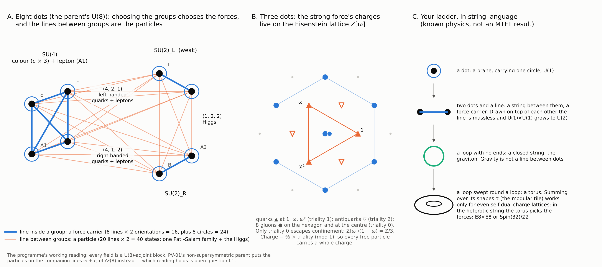
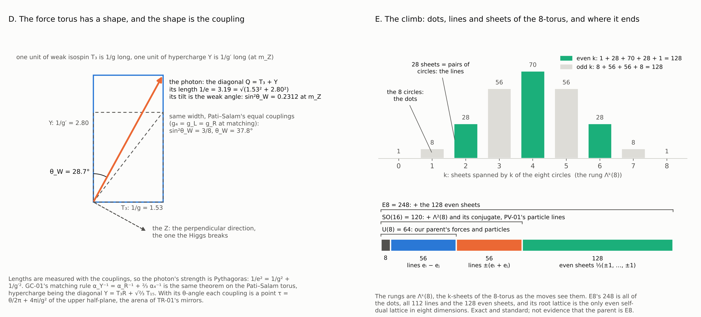
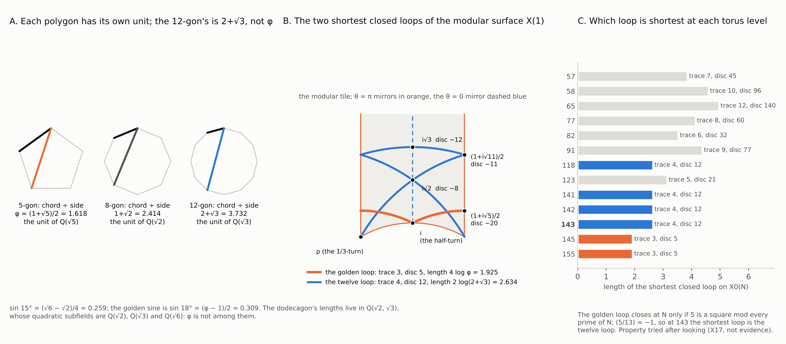

# GF-01 — forces first: the eight dots, what the forces fix, the three parent columns, and the clock of twelve (2026-10-11; corrected the same day after independent review, CC-64)

Module `mtft.matter.forces`; tests `tests/test_gf01_forces.py`; figures `scripts/gf01/` (write `docs/SM/figs/gf01_*.png`); command line
`python -m mtft matter forces [--json] [--touch PARENT] [--column PARENT] [--box N]`. Seals PR-S3 and PR-S5 (PR-S4 superseded, CC-64) and
trial X17 are in `mtft.matter.prereg`.

The question of this wave was whether to take the forces on before the fermions, on the reading that a particle is a line between two dots of the
force picture and so follows once the forces are placed. The answer is yes at the level of kind, and the wave records what that buys and what it
does not: the particles' representations, charges and Yukawa triangles follow from the grouping of the dots; their numbers follow from topology; and
among the supersymmetric parents, the columns that would let a condensate reach the down sector are the ones that do not give the exact Standard Model.

1. **The engine (EXACT).** A gauge group of rank 8 is eight dots, one circle U(1) each, the maximal torus T^8; every operation of the group is
   conjugate to a point of it (Cartan). A group of n coincident dots is U(n), whose force carriers are the n circles and the n(n - 1) lines inside the
   group (the roots e_i - e_j); the lines between groups are the particles. Grouped (4, 2, 2), the 64 states of U(8) are 24 carriers and 40 particle
   states — one Pati–Salam family (4, 2, 1) + (4bar, 1, 2) and the Higgs (1, 2, 2), 20 states, with their 20 conjugates; grouped
   U(3) x U(1) x U(2) x U(1) x U(1) they are 16 carriers
   (the Standard Model's twelve and four extra U(1)s) and 48. Three kinds of line occur in the parents the programme has considered: the difference
   line e_i - e_j is the bifundamental Hom(j -> i) = V_i (x) V_j^* (PS-01's orientation, hypercharge Y_i - Y_j; DS-01 lists the conjugate orientation);
   the sum line e_i + e_j is the block V_i (x) V_j of Lambda^2(8), PV-01's non-supersymmetric content; a sheet on k dots is Lambda^k(8), and the 128
   even sheets, with charge k_s - n_s/2 on each stack, are the spinor of SO(16) that E8 adds. The Standard-Model fields are the difference lines of the
   second grouping with PS-01's hypercharges, and the four Yukawa couplings are the four triangles of dots whose third side is the Higgs: Q u^c H_u on
   (L, c, A2), Q d^c H_d on (L, c, B), L e^c H_d on (L, A1, B), L nu^c H_u on (L, A1, A2) — so H_u is the line (L, A2) and H_d the line (L, B), as
   DS-01 has them. The engine reproduces PS-01's branching, DS-01's charge table and touch numbers, and PV-01's 28 blocks of Lambda^2(8) in twelve
   stack blocks; eight dots can be grouped in 22 ways (GF-1). The strong force's charges live on Z[omega]: the three colour dots carry the weights
   1, omega, omega^2, the gluons sit on the hexagon (1 - omega) x units and at the centre, and Z[omega]/(1 - omega) = Z/3 is the triality that
   confinement keeps.

2. **The touch scan (STRUCTURAL; sealed PR-S3, outcome mixed).** DS-01's criterion — a condensate on a block of charge vector q_s reaches a field of
   charge vector q_f at first order iff q_s . q_f != 0 — was sealed with the pass window "some Standard-Model-singlet block of the parent's menu reaches
   d^c or H_d" and run on the three supersymmetric menus. U(8): the only singlet block is the nu^c line on A1–A2; it reaches L, u^c, e^c, nu^c and
   H_u and never Q, d^c or H_d — DS-1 restated as a property of the menu (FAIL). SO(16): the sum lines B+A2, A1+B and Lambda^2(L) reach the down
   sector (PASS). E8: those and six spinor sheets (PASS). With item 7 the reading is the opposite of a loophole: within these menus the blocks that
   reach d^c at first order live in columns that do not give the exact Standard Model, so the down-sector wall of piece IX is a statement about the
   supersymmetric parents, not about one design. PV-01's non-supersymmetric U(8) carries the same sum lines, as fermions only — its scalars are the
   adjoint's internal components, the difference lines, so no condensate can sit on a sum line there — and was not scanned (GF-13; IX.10; GF-2 was
   the same statement with the scope over-claimed, superseded by CC-64).

3. **Charge quantisation (STRUCTURAL; sealed PR-S5, outcome pass; PR-S4 superseded the same day, CC-64).** The generator (omega, -1, e^{2 pi i/6})
   of the centre Z3 x Z2 x U(1)_Y, with U(1)_Y acting by e^{2 pi i Y}, acts on a block by e^{2 pi i (t/3 + d/2 + Y)}, t the triality and d the weak
   duality. It is trivial on all eight Standard-Model lines, so the matter allows the gauge group [SU(3) x SU(2) x U(1)]/Z6 or any of its covers (the
   quotient by a subgroup of Z6 — the first seal had this backwards, "a further quotient", and was re-sealed with the criterion unchanged), and the
   electric charges of a block's components are (2/3) t mod 1: every free (colour-neutral) particle carries a whole charge. The rule passes for every
   odd T_3R coefficient of the anomaly-free family of item 4, so it is necessary and not what fixes hypercharge (GF-10; V.7).

4. **Hypercharge by two routes (EXACT; the E2 rule).** Route A, anomalies on the stack U(1)s: with the Standard-Model fields as lines, one generation
   is anomaly-free (SU(3)^2 Y, SU(2)^2 Y, grav^2 Y, Y^3) for every stack assignment in the two-dimensional space <T_3R, B - L>, because the
   gravitational and cubic conditions are identities once the two nonabelian ones hold. Y(Q) = 1/6 fixes the B - L coefficient. What fixes the T_3R
   coefficient a is that the Higgs line (L, A2) has hypercharge a/2 and must contain a neutral component for the photon to survive electroweak
   breaking: a = +-1. (a = 3 passes the anomalies and Z6 and gives a Higgs of charges 1 and 2.) a = -1 is the relabelling B <-> A2, the u <-> d swap.
   Route B is the Pati–Salam embedding Y = T_3R + (B - L)/2 with (B - L)/2 = sqrt(2/3) T_15. Both land on (1/6, -1/2, 0, 1/2, -1/2) (GF-4). The
   textbook statement that anomalies fix hypercharge up to scale is for fifteen fields; with nu^c the standard two-parameter family Y + x (B - L)
   reappears here as <T_3R, B - L> on the stacks.

5. **Couplings as torus geometry (EXACT; NUMERICAL placements).** Lengths on the force torus are measured with the couplings: a unit of weak isospin
   T_3 is 1/g long, a unit of hypercharge 1/g'. The photon is the diagonal Q = T_3 + Y, of length 1/e by Pythagoras — 1/e^2 = 1/g^2 + 1/g'^2 exactly —
   and the weak angle is the diagonal's tilt: 28.74 degrees at m_Z (sin^2 = 0.2312), 37.76 degrees (sin^2 = 3/8) at Pati–Salam's equal couplings.
   GC-01's matching alpha_Y^-1 = alpha_R^-1 + (2/3) alpha_4^-1 is the same theorem on the Pati–Salam torus, and its R is the ratio of cycle-length
   differences (l_R^2 - l_4^2)/(l_L^2 - l_4^2), which the flux designs quantise to 1/9 ... 9 or 1/5, 1, 5 against the data's 3.678 (GC-3). Each coupling
   with its theta is the point tau = theta/2 pi + i/alpha of the upper half-plane; at theta = 0 these sit on the theta = 0 mirror by assumption and are
   not candidates for the sealed strong-CP test PR-S2 (GF-5; VI.6).

6. **The three parent columns of I.1 (EXACT, finite).** With PV-02's supersymmetric twist the net chirality of a block is linear in its charge
   vector, net = q . phi with phi_s = e_s - 24 b_s the twist index of stack s, so "exactly the Standard Model plus vector-like pairs and sterile
   singlets" is a linear Diophantine system in five unknowns, one row per representation the menu can produce. U(8), difference lines only: rank 3
   of 5, consistent; the solutions are PV-02's phi_c - phi_L = 3, phi_B - phi_c = 3, phi_A1 + phi_A2 - 2 phi_c = 3, eighteen in the box of 4, every
   one with six doublet pairs (GF-6). PV-01's non-supersymmetric U(8), the particles on the sum lines and the dots, has bilinear indices and is cited
   from its own scan (60 and 156 assignments), not recomputed.

7. **SO(16) and E8 through U(8) are closed (EXACT).** A parent that contains both roots e_c - e_L and e_c + e_L has two (3, 2) lines, of
   hypercharges y_c - y_L and y_c + y_L and chiralities phi_c - phi_L and phi_c + phi_L. With the stack hypercharge both are quark doublets and their
   net is 2 phi_c, never 3. A shift of the hypercharges by s on every dot (invisible to difference lines, charge 2s on sum lines) makes the sum line
   an exotic (3, 2)_{1/6 + 2s} with no partner in the menu, so it must vanish, phi_c + phi_L = 0, against Q = phi_c - phi_L = 3 — again 2 phi_c = 3.
   That is the parity obstruction; over the rationals the obstruction is already in the leptons, where the (1, 2)_{-1/2} row and the (1, 1)_{+1} row
   are negatives of each other, net(L) + net(e^c) = 0 against 3 + 3 (the review's certificate). E8 adds the sheets, among them three more Q-type
   blocks (the 2-sheet c+L seen as its conjugate 6-sheet and the 4-sheets {c, L, A1, B} and {c, L, B, A2}) and an exotic (3, 2)_{-5/6}; three quark
   doublets are then possible, phi = (6, 0, 0, 0, 0), but the exotic row is minus the Q row, so they come with three chiral exotic doublets, and the
   lepton rows conflict as before. Both systems are inconsistent over the rationals at every shift in (1/48) Z on [-2, 2] (193 each), at every
   special shift where block hypercharges coincide (denominators 1, 2, 4 for SO(16) and 1, 2, 4, 6 for E8, all on that lattice) and at a generic
   shift, hence for every real shift. So the ladder's upper rungs decide: a supersymmetric SO(16) or E8 reached through U(8) with hypercharge from the
   stacks does not give the exact Standard Model (GF-11; N21; GF-7 said "cannot give three quark doublets", false for E8, superseded by CC-64). Not
   addressed: other embeddings of the Standard Model in E8 (the heterotic SU(5) x U(1)^5 line-bundle route is a different menu), and D-flatness or
   stability of any background (I.3). Among the three columns, I.1 is now a two-way choice: a supersymmetric U(8) with the particles on its
   difference lines, or PV-01's non-supersymmetric U(8).

8. **The clock of twelve (EXACT).** SL(2,Z) is generated by S (order 4, S^2 = -1, the fermion sign) and ST (order 6; on the upper half-plane a
   120-degree turn about rho, the corner where TR-01's oloid and triangle mirrors, both of the theta = pi class, meet at 60 degrees), and its
   abelianisation is Z/12 — the character eta^2 carries (eta(tau + 1) = e^{2 pi i/24} eta(tau), so Delta = eta^24 has weight 12); PSL(2,Z)^ab = Z/6.
   Z/12's subgroups have orders 1, 2, 3, 4, 6, 12. At level 143 the twelve is g - 1 = (11 + 13)/2 =
   deg K^{1/2}, the spin twist (12, 0), and the pivot of the five means of 11 and 13: 143/12, sqrt 143, 12, sqrt 145, 145/12 with HM x AM = 143 and
   AM x CHM = 145. In the colour plane the six weights and six roots point 30 degrees apart with lengths 1 : sqrt 3 — the twelve roots of G2, whose
   Weyl group has order 12 — and the Standard Model has twelve force carriers (the Weyl group of the U(3) x U(2) grouping also has order 12). These
   are exact and they are coincidences of size: the Z6 of the Standard Model and the Z/6 of PSL(2,Z) match in order and nothing here maps one to the
   other (AG-D5). On X(1): the golden loop (trace 3, discriminant 5, length 4 log phi = 1.925) passes through i and crosses the theta = pi mirror at
   (1 + i sqrt 5)/2, discriminant -20, the ambiguous class (2, 2, 3); the twelve loop (trace 4, discriminant 12, length 2 log(2 + sqrt 3) = 2.634)
   passes through rho and crosses the mirrors at i sqrt 2 (discriminant -8, twice), i sqrt 3 (-12, once) and (1 + i sqrt 11)/2 (-11, twice): two
   transversal self-crossings, one on each mirror class (the passages meet at 70.5 and 33.6 degrees); the loop runs rho -> i sqrt 2 -> (1 + i sqrt 11)/2
   -> i sqrt 3 -> (1 + i sqrt 11)/2 -> i sqrt 2 -> rho. A loop with real endpoints alpha, alpha' crosses the theta = 0 mirror at
   i sqrt(-alpha alpha'), so every mirror crossing is a CM point, of the class TR-01 assigns. The golden loop is reversed inside SL(2,Z) by the half-turn S at i (S M S^-1 = M^-1; phi has norm -1); the twelve loop is reversed only
   by a mirror, because x^2 - 3 y^2 = -1 is impossible mod 3 (2 + sqrt 3 has norm +1), so its two directions are different closed loops on X(1). And
   X(5) is the icosahedron — index 60, twelve cusps at the vertices (0, +-1, +-phi), 30 half-turn points at the edges, 20 third-turn points at the
   faces, genus 0 — a place where twelve and phi meet exactly in the modular world, at level 5 (GF-12; II.11; GF-8 superseded by CC-64 for the
   missed second self-crossing, the turn angle at rho and the superlative).

9. **The systole of X0(143) is the twelve loop (EXACT).** A loop of trace t closes at level N iff x^2 - t x + 1 = 0 is solvable mod N; for odd squarefree N
   that is "t^2 - 4 a square mod every prime of N", and at even N every trace is even. The golden loop needs 5 to be a square mod 13, and (5/13) = -1,
   so it does not close at 143; the twelve loop does ((3/11) = (3/13) = 1): the systole has discriminant 12 and length 2 log(2 + sqrt 3), already in
   `one_loop_adjoints.systole_X0_143` (M05-3). 2 + sqrt 3 is the fundamental unit of Q(sqrt 3) and the dodecagon's own ratio, chord to side =
   tan 75 degrees, the way phi is the pentagon's and 1 + sqrt 2 the octagon's; phi is not in the dodecagon's field Q(sqrt 2, sqrt 3), whose quadratic
   subfields are Q(sqrt 2), Q(sqrt 3) and Q(sqrt 6). (The identity sin 15 = (phi - 1)/sqrt 2 in the summary that prompted this wave is false:
   sin 15 = (sqrt 6 - sqrt 2)/4 = 0.259 and the golden sine is sin 18 = (phi - 1)/2 = 0.309; its dodecagon formulas and its dodecahedron paragraph
   are right.) Among the thirteen torus levels the twelve loop is the systole at 118, 141, 142 and 143 and the golden loop at 145 and 155, the two
   levels divisible by 5. This was computed in the reply before it was logged, so it enters the trials counter as X17 — selects four of thirteen,
   includes 143, tried after looking — and is not evidence for the level (GF-9; IV.6).

Independent check (2026-10-11): a separate pass recomputed every number of the wave from its own construction — the root systems of SO(16) and E8
(112 and 240 roots) restricted to the five stacks, the anomaly space, the tori, the Smith forms, the systoles, the loops by direct flow, the units —
and found no numerical discrepancy; it found eight statements to correct (the scope of GF-2, the direction of the global-form reading in GF-3 and
PR-S4, the E8 wording of GF-7, the second self-crossing and the turn angle in GF-8, three smaller wordings), all applied the same day as CC-64, with
the three claims and the seal superseded rather than edited.

Reading. The forces fix what a family is — its lines, charges, Yukawa triangles and global form — and the arena fixes how many: with the twist, three
families is a linear condition on the stack twist indices, and among the three columns only U(8) satisfies it. The twelve that the question began from
is the clock of the duality group and the systole of our own curve; the golden ratio is what the level 143 refuses and what level 5 hosts. Nothing in
this wave derives the level or a constant, and two sealed rules now have outcomes: PR-S5 passes, PR-S3 is mixed in the way that sharpens a wall.
