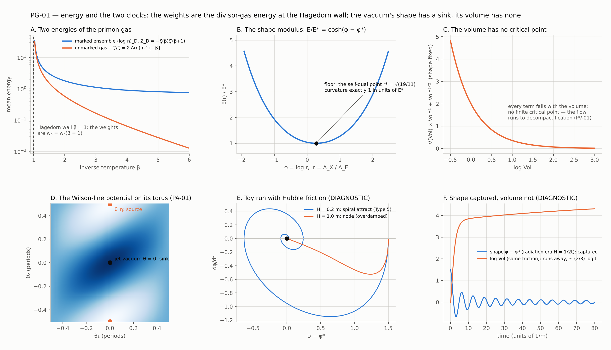

# PG-01 — energy and the two clocks: the weights as the primon gas's energy, the vacuum as a dynamical system, and the simulation gate (2026-10-12; corrected the same day, CC-65)

Modules `mtft.divisor_gas` (the arithmetic clock; Legend entries `divisor_gas_energy`, `two_primon_energies`, `mean_weight_glaisher`,
`alphabet_negative_values`, `clock_is_zeta_minus_one`) and `mtft.matter.vacuum_atlas` (the matter clock; ledger PG-1 to PG-5, with PG-2 and PG-3
superseded by PG-4 and PG-5 under CC-65); tests `tests/test_pg01_energy.py`; figure `scripts/pg01/pg01_figure.py` -> `docs/SM/figs/pg01_energy_clocks.png`;
command lines `python -m mtft.divisor_gas` and `python -m mtft matter atlas [--json]`.

The question of this wave was whether the primon gas's algebra can be used for energy, on the way to a simulation that runs from a hot symmetric start to
matter. The answer has two halves that must not be confused: the arithmetic side has a clock, an energy and a phase transition, all exact; the matter
side has potentials whose critical points can be classified exactly, but no stationary point in the volume, so the run the programme wants cannot yet
start. No map between the two clocks is claimed (AG-D5). The independent review of the wave confirmed every number and corrected five sentences; the
corrections are filed as CC-65 and listed in section 4, and the text below is the corrected one.

## 1. The arithmetic clock

1. **The weights are an energy (EXACT).** In the primon gas the primes are the particles, n = prod p^k is the state with occupation numbers k, its energy
   is log n, and energy adds when states multiply: the loggy laws, log(mn) = log m + log n, are the gas's additivity. Unique factorisation makes every
   level of multiplicity one, so the full gas has Z(beta) = zeta(beta) and the Hagedorn wall at beta = 1. The weight
   w_n = sum_{d|n} (log d)/d is the energy numerator of n's divisor gas — the sub-states d of n, each with energy log d and Boltzmann factor d^-beta —
   at beta = 1: w_n(beta) = sum_{d|n} log d . d^-beta = -d/dbeta sigma_{-beta}(n), and w_n = w_n(1), checked against the package's sieve for n <= 500 to
   10^-15. Its Dirichlet series is -zeta(s) zeta'(s + beta); at beta = 1 that is the alphabet -zeta(s) zeta'(s+1) = Z_D(s) of `marked_gas`, which already
   treats it as a Gibbs state with Hamiltonian log n and a KMS condition. 143 = 11 x 13 has four divisors and w_143 = 0.450; 144 has fifteen and
   w_144 = 2.810 (`divisor_gas_energy`).
2. **Two energies (EXACT).** The marked ensemble's internal energy U_D(beta) = <log n>_D = -d log Z_D/dbeta, with heat capacity beta^2 Var(log n), sits
   beside the unmarked gas's U(beta) = -zeta'(beta)/zeta(beta) = sum Lambda(n) n^-beta, the von Mangoldt series, whose poles are the zeros of zeta
   (at beta = 2: 1.780 against 0.570, the latter checked as a prime sum to 2 x 10^4). Exactly, U_D(beta) = U(beta) - zeta''(beta+1)/zeta'(beta+1): the
   marked energy contains the von Mangoldt series as a summand, keeps every one of its poles at the zeros of zeta (residue -1, checked at rho_1) and adds
   poles at the zeros of zeta' shifted by one. Marking does not move the energy off the zeros, it adds singularities. What is RH-blind is the partition
   function and the summatory function: Z_D(s) = -zeta(s) zeta'(s+1) is entire except at s = 1 and vanishes at the zeros of zeta, so
   sum_{n<=x} w_n = -zeta'(2) x - (1/4) log^2 x - (1/2)(ln 2 pi) log x + O(1) carries no term from the zeros. Both partition functions have their first
   singularity at beta = 1, and the residue of Z_D there is -zeta'(2), the mean weight (`two_primon_energies`; the first filing said the opposite, CC-65).
3. **The mean weight in Glaisher's constant (EXACT).** sum_{n<=x} w_n ~ -zeta'(2) x with -zeta'(2) = (pi^2/6)(12 ln A - gamma - ln 2 pi) = 0.9375482543,
   A the Glaisher–Kinkelin constant (0.9359 at x = 2 x 10^4; the error of the density is -log^2 x/(4x) + O(log x/x), from the triple pole of
   Z_D(s) x^s/s at s = 0, and the computed error matches that term to a few per cent). The 12 multiplying ln A is -1/zeta(-1) = 2 pi^2/zeta(2), the
   functional equation at s = 2; the prefactor is zeta(2) (`mean_weight_glaisher`).
4. **The alphabet at the negative integers (EXACT).** W(-k) = -zeta(-k) zeta'(1-k) = zeta(-k) (ln A_{k-1} - B_k H_{k-1}/k) with A_k the Bendersky–Glaisher
   constants (A_0 = sqrt(2 pi), A_1 = A): the convolution 1 * (log d)/d at s = -k is the regularised sum of n^k times the regularised sum of
   n^{k-1} log n. The Bendersky identity is the definition of A_{k-1} rearranged, not a theorem about the alphabet; the closed forms at odd k are the
   functional equation zeta'(-2m) = (-1)^m (2m)! zeta(2m+1)/(2 (2 pi)^{2m}). So PV-02's W(-1) = -(ln 2 pi)/24, filed there as "exact identity; meaning
   open", reads: (1 + 2 + 3 + ...) x (ln 1 + ln 2 + ln 3 + ...), both regularised — the twelve from zeta(-1) and the two from zeta'(0) = -ln sqrt(2 pi).
   Then W(-2m) = 0 (the trivial zeros), W(-3) = zeta(3)/(480 pi^2), W(-5) = zeta(5)/(336 pi^4), and Glaisher's A itself sits at the derivative at the
   first trivial zero, W'(-2) = (zeta(3)/4 pi^2)(1/12 - ln A) (`alphabet_negative_values`).
5. **The clock's Euler characteristic is zeta(-1) (EXACT).** chi(SL(2,Z)) = 1/4 + 1/6 - 1/2 = -1/12 is the rational (Wall–Serre) Euler characteristic of
   the amalgam Z/4 *_{Z/2} Z/6 of GF-01, equal to zeta(-1) by the K = Q case of Harder's Gauss–Bonnet theorem chi(SL_2(O_K)) = zeta_K(-1); eta's
   q^{1/24} is the zeta-regularised (1/2) sum n = zeta(-1)/2; and the genus formula reads as orbifold Gauss–Bonnet, g - 1 = -mu chi - nu_2/4 - nu_3/3 - c/2
   with Area(X(1))/4 pi = 1/12: at level 143, 168/12 - 2 = 12 (`clock_is_zeta_minus_one`, function `euler_characteristic_is_zeta_minus_one`). That the
   abelianisation of GF-01's clock has order 12 = 1/|chi| is a coincidence of size, not a map (AG-D5). The dimensional-bridge chain -1/12 -> eta -> Delta in
   the package's pheno tier shares these exact first steps; nothing here touches its last one.
6. **The transition (standard, quoted).** The Bost–Connes system has a unique KMS state for 0 < beta <= 1 with the symmetry Gal(Q^ab/Q) = Zhat^*
   unbroken, extremal KMS states parametrised by that group for beta > 1 (the symmetry spontaneously broken), and ground states on which the arithmetic
   subalgebra takes values in Q^ab with the Zhat^* action intertwining the Galois action — the isomorphism Gal(Q^ab/Q) = Zhat^* is an input of that
   construction, not an output. The package's `marked_gas` is its own Gibbs construction on l^2(N >= 2) whose construction note deforms the Bost–Connes
   symmetry twist in the infrared; it is not a KMS state of the Bost–Connes algebra, and nothing about that algebra is claimed here. The weights are
   w_n(beta) at beta = 1, the parameter value of the Bost–Connes critical point; the divisor gas of one n is finite and has no transition, and nothing
   follows from the coincidence of parameter values. What this is: a rigorous hot-symmetric to cold-broken transition in arithmetic, available as a
   reference. What it is not: a physical temperature; no map from beta to one is claimed.

## 2. The matter clock: the vacuum as a dynamical system

The eight types of three-dimensional critical point are the sign and reality patterns of a linearisation's eigenvalues: three real eigenvalues give
the source, the sink and the two saddles; a complex pair with a real eigenvalue gives the four spirals. For a gradient flow the eigenvalues are minus the
Hessian's, so a minimum is a sink and a maximum a source; a zero eigenvalue is non-hyperbolic and outside the eight.

7. **The shape well (EXACT; PG-1).** With phi = log r the flux landscape of PV-01, E(r) = 4 pi^2 (A/r + B r) with A = 19, B = 11 for S1 and S2, is
   E/E* = cosh(phi - phi*), floor at the self-dual point r* = sqrt(19/11) = 1.314 and curvature exactly 1 at the floor in units of E* = 8 pi^2 sqrt(AB):
   a sink. Reading phi as the canonical field is the natural log metric of a ratio modulus and is not derived here.
8. **The atlas (EXACT, each result with its hypothesis; PG-4).** Volume: with both Einstein-frame coefficients positive, as PV-01 finds them, both terms,
   E(r) Vol^-2 and the curvature term r^-1/2 Vol^-3/2, fall with Vol, so there is no finite critical point and the gradient flow runs to
   decompactification (PV-01; negative N22). Condensate: the D-term potential V = (1/2)[(u - xi)^2 + (5/8) u^2], u = v^2 - vbar^2, has at its minimum
   v^2 = (8/13) xi a zero Hessian eigenvalue along vbar (the flat family u = const): non-hyperbolic; a mass term m^2 (v^2 + vbar^2) with 0 < m^2 < xi
   moves the minimum to v^2 = (8/13)(xi - m^2) and lifts that eigenvalue to exactly 4 m^2 — a sink, CO-1's "any positive mass" made quantitative (for
   m^2 >= xi the minimum is at the origin). Wilson line: on the torus of the relative U(1), V(theta) = -2 sum_{odd w} |w|^-8 cos(2 pi theta . w) has
   a two-dimensional sink at the jet vacuum theta = 0 (Hessian eigenvalues 28.9 and 166.9 in the real spin structure) and a two-dimensional source at
   the untwisted point theta_eta (the negatives), for all three even spin structures — exact in PA-01's product approximation to the potential, which is
   the standing of PA1-1 itself; these are the full Hessians behind PA1-1's statement along the straight path. Adjoints: sinks (M05-1). A_X at one loop:
   no Casimir minimum (MS-6). No saddle appears anywhere in the atlas, and no spiral: spirals need time.
9. **Friction and the toy (STRUCTURAL; DIAGNOSTIC; PG-5).** With Hubble friction 3H a sink of mass m has eigenvalues (-3H +- sqrt(9H^2 - 4m^2))/2:
   a spiral (Type 5, spiral attract) iff m > 3H/2, a node otherwise. So the type of every sink in a cosmological run is set by m/H, which the
   programme has not fixed. Capture of the shape at the self-dual point is guaranteed by the energy argument, not by any run: E = phi'^2/2 +
   cosh(phi - phi*) - 1 has dE/dt = -3H phi'^2 <= 0 for any H(t) > 0 and the well has one critical point, so every trajectory ends at the floor
   (`energy_argument` checks it on each run). The toy run phi'' + 3H phi' + sinh(phi - phi*) = 0, in units where the floor curvature is 1, only
   illustrates it: a spiral for H = 0.2 m (18 floor crossings in a run of length 60/m, 15 in one of length 50/m — the count grows with the run and
   is not a result), a spiral in a radiation era H = 1/2t, and a node for H = m. log Vol under the same constant friction rises without bound, but only
   like (2/3) log t at late times in the toy (the slower Vol^-3/2 term dominant and the motion overdamped). The normalisation of H against the modulus
   mass is not derived, which is the point of the gate.

## 3. The simulation gate (I.7)

A run from a hot start to matter, in which the programme's own forces and particles act, needs in order: a declared parent (I.1, now a two-way choice
after GF-01); a vacuum energy computed from the parent action with a stationary point in the volume (I.6, GS-1's fixed Kaehler moduli) — today the
classical terms run away and the one-loop Casimir has no minimum; the couplings as functions of the moduli at the stabilised point (GC-01, VI.1); a
cosmological background to supply H(t), since the package's Friedmann module is pheno-tier; and then standard physics at confinement and
nucleosynthesis, which should be used, not re-derived. What runs today is the shape modulus and the volume's runaway. The gate is recorded as
sub-puzzle I.7 so that every later wave can be measured against it.

## 4. Corrections the same day (CC-65)

An independent checker recomputed every number of the wave from scratch — the Hessians, the Glaisher and Bendersky identities, the alphabet's values,
the genus formula at the thirteen levels, the toy run — and all agreed. The prose did not, in five places, and the corrections are filed append-only:
PG-2 and PG-3 are superseded by PG-4 and PG-5, and the Legend texts and this report carry the corrected sentences.

- The RH sentence was false. The first filing said marking by w_n moves the energy off the zeros of zeta. Exactly U_D = U - zeta''(beta+1)/zeta'(beta+1),
  so the marked energy keeps every pole at the zeros (residue -1, checked at rho_1) and adds poles at the shifted zeros of zeta'. RH-blindness belongs
  to Z_D and to the summatory function, whose error is O(log^2 x/x), not O(log x/x).
- "The twelve in front is zeta(-1)" was loose: the 12 multiplying ln A is -1/zeta(-1) = 2 pi^2/zeta(2), the functional equation at s = 2.
- The Bendersky identity is the definition of A_{k-1} rearranged, and the odd-k closed forms are the functional equation; neither is a theorem about the
  alphabet. The attribution of chi(SL(2,Z)) = -1/12 is Wall–Serre for the rational Euler characteristic and Harder (K = Q) for the equality with
  zeta(-1); that |SL(2,Z)^ab| = 12 = 1/|chi| is a coincidence of size (AG-D5). The Bost–Connes paragraph now says what the marked gas is and is not.
- Three atlas results were stated without their hypotheses (the signs of the volume coefficients; 0 < m^2 < xi; PA-01's product approximation).
- A run-length-dependent count (18 crossings) was presented as a result; capture rests on the energy argument, the flag in the code is a smoke test, and
  the volume's rise in the toy is logarithmic.

Reading. The loggy function was always an energy: the primon gas's, for the sub-states of n, at the parameter value beta = 1 where the full gas has its
transition — a coincidence of parameter values from which nothing follows. The vacuum's shape has a floor and the Wilson line a basin; its volume has
nothing to fall into. The clock of GF-01 has Euler characteristic zeta(-1), and the Glaisher constant is what comes after it in the mean weight.

## 5. Addendum (2026-10-14, append-only): the Wilson-line torus has two saddles (PG-6, CC-66)

Module `mtft.matter.vacuum_atlas` (`wilson_line_torus`, `kinetic_metric`, `saddle_pairing`; `atlas()` now lists the saddles); ledger PG-6 (new)
and CC-66 (caveats PG-4); tests `tests/test_pg01_wilson_torus.py`, two routes — the package's Newton census on PA-01's box lattice, and in the
test an independent sum over the disc |w| <= 40 with a winding-number count, a Lipschitz exclusion and a contraction bound; visual
`viz/wilson_line_torus.html`. Nothing above is edited.

- **Two saddles (EXACT that the half-periods are critical; NUMERICAL, by two routes, that there are no others).** Item 8's sink and source are
  the critical points PA-01's straight path meets. On the whole torus R^2/Z^2 (the one-loop potential in PA-01's product approximation, item 8's
  standing), the four half-periods are critical points because V(-theta) = V(theta), and both routes find no others: the sink at theta = 0, the
  source at theta_eta = eps/2, and saddles at the other two half-periods, all four nondegenerate. For a Morse function on the torus
  #min - #saddle + #max = chi(T^2) = 0, so one minimum and one maximum force exactly two saddles. So "No saddle appears anywhere in the atlas"
  held only along the path (CC-66) — and BL-3 had already found these half-periods to be saddles for the B–L Wilson line, whose potential has the
  same form, so the sentence conflicted with an active claim when it was filed. PA1-1 is unchanged: the jet vacuum is still the only minimum; the
  saddles are the passes through which the holonomy can wind around the torus.
- **Their values.** Real spin structure: V = -3.178063 at the sink, 0 and 0 at the saddles, +3.178063 at the source. The saddle zeros are exact
  (in PA-01's product approximation): (m, n) -> (-m - n, n) keeps |m + n tau| when Re tau = 1/2 and flips the parity of m when n is odd, so the
  odd windings cancel in pairs at (1/2, 0) and (1/2, 1/2) (summed over a disc, which the pairing preserves, the residue is at rounding level).
  The conjugate pair: -5.991688, -2.813625, +2.813625, +5.991688, and the same pairing gives V_(1,0)(0) = V_(1,0)(0, 1/2) + V_(0,1)(0) exactly.
- **Curvatures belong to the kinetic metric.** The Hessian eigenvalues 28.9 and 166.9 of item 8 are in theta-coordinates. The kinetic metric of the
  Wilson-line moduli is 143a1's Hodge metric G = [[|tau|^2/y, -x/y], [-x/y, 1/y]] (det 1), and small oscillations go with the eigenvalues of
  G^-1 H: 37.394 and 128.985 in the real spin structure (the same product), a ratio of Wilson-line masses of 1.857 rather than 2.404. A
  consistency check on G (necessary, not sufficient): the spin structures with eta at tau/2 and at (1 + tau)/2 are mirror images under the
  curve's real structure; their theta-coordinate eigenvalues differ (46.0, 257.5 against 65.5, 180.9) and their metric eigenvalues agree
  (60.834, 194.868).
- **Why there is a force at all (STRUCTURAL).** The weight -2 on odd windings is -(1 - eta(w)), bosons minus fermions: even windings cancel and,
  with no Scherk–Schwarz twist (eta = 1), the potential vanishes identically. The force on the Wilson line is made by the twist.

Reading. The Wilson line's basin has two passes; its floor is where PA1-1 put it. The saddles appear as soon as the whole torus is examined
instead of the one path, and for a Morse function the count says they had to be there.
