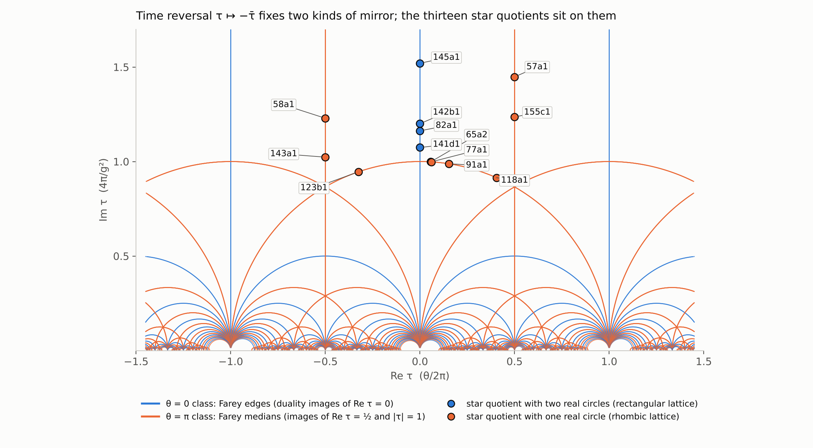

# TR-01 — time reversal: the two mirror classes, the thirteen star-quotient curves, and the sealed strong-CP test (2026-10-10; corrected the same day, CC-63)

Module `mtft.matter.time_reversal`; tests `tests/test_tr01_time_reversal.py`; provenance `scripts/time_reversal_curves.py` (needs cypari2 with
elldata); command line `python -m mtft matter timerev [--json] [--candidate KIND VALUE [--det-phase PHI] [--tolerance T]]`.

Time reversal acts on a gauge coupling tau = theta/2pi + 4 pi i/g^2 as tau -> -conj(tau). Its fixed lines are theta = 0 (Re tau = 0) and theta = pi
(Re tau = 1/2). Under the duality group these lines sweep out mirrors of the modular tiling, and the question was whether a duality can carry one
kind to the other, which would make "theta = 0" and "theta = pi" the same condition seen from two tiles. It cannot.

1. **Two classes, two routes (EXACT).** A reflection of the upper half-plane is an integer matrix of determinant -1 and trace 0 acting by
   tau -> (a conj(tau) + b)/(c conj(tau) + d); its mirror is the geodesic c(x^2 + y^2) - 2ax - b = 0, with cusp endpoints (a -+ 1)/c (for c = 0,
   x = -b/2a and infinity). Route 1: the fixed form (c, -2a, -b) has discriminant 4 and content gcd(c, 2a, b) = 2 or 1, a conjugacy invariant.
   Route 2: the endpoint cusps p/q, r/s have |ps - qr| = 1 (Farey neighbours) or 2. The routes agree on all 106 reflections (212 matrices, M
   and -M acting alike) with entries up to 12, and content is conjugation-invariant under five test matrices. Content 2 = Farey edges = the
   images of theta = 0; content 1 = Farey medians = the images of theta = pi. These are the two conjugacy classes of reflections of PGL(2, Z):
   in the (2, 3, infinity) triangle group only the label 3 is odd, joining the reflections in |tau| = 1 and Re tau = 1/2, while Re tau = 0 meets
   them at the labels 2 and infinity. So no duality carries theta = 0 to theta = pi (TR-1).
2. **Where the programme's mirrors sit (EXACT).** The oloid move q -> -q/(1 + q), the triangle mirror n -> -1 - n (the Holes and Charges note) and
   143a1's own period lattice are all of the theta = pi class: 143a1's discriminant -1859 is negative, so its lattice is rhombic with Re tau = 1/2
   exactly and its real points form one circle (TR-2).
3. **The thirteen star quotients as curves (EXACT; PARI 2.17.2 elldata, frozen and reproduced).** At each torus level of SQ-01 the (+, +) isogeny
   class is the one with a_p = a_q = -1, and in it exactly one curve has modular degree 4 = |<W_p, W_q>|: a degree-4 Atkin–Lehner-invariant
   parametrisation of a curve in the class pulls the Neron differential back to m times 2 pi i f dtau with m a nonzero integer (lambda times the
   Manin constant, both integers; the Manin constant is 1 here by Cremona), and its degree is m^2 times the curve's modular degree as PARI
   defines it (degree over the Manin constant squared). So 4 = m^2 d with d in {1, 4}, and d = 1 occurs in none of these classes (every curve has
   degree 2, 4 or 8), so the quotient is the degree-4 curve. It is the optimal curve everywhere except at 65, where 65a1 has degree 2 and the
   quotient is 65a2 = [1, 0, 0, 4, 1] with discriminant -65^2 — the Atkin–Lehner involutions act on 65a1 by translation by its 2-torsion point,
   and on the other twelve optimal curves by the identity, as the independent check confirmed from modular symbols at the cusps.

   | N | curve | discriminant | real circles | lattice | root number | rank |
   |---|---|---|---|---|---|---|
   | 57 | 57a1 | -171 | 1 | theta = pi | -1 | 1 |
   | 58 | 58a1 | -116 | 1 | theta = pi | -1 | 1 |
   | 65 | 65a2 | -4225 | 1 | theta = pi | -1 | 1 |
   | 77 | 77a1 | -539 | 1 | theta = pi | -1 | 1 |
   | 82 | 82a1 | 164 | 2 | theta = 0 | -1 | 1 |
   | 91 | 91a1 | -91 | 1 | theta = pi | -1 | 1 |
   | 118 | 118a1 | -236 | 1 | theta = pi | -1 | 1 |
   | 123 | 123b1 | -123 | 1 | theta = pi | -1 | 1 |
   | 141 | 141d1 | 141 | 2 | theta = 0 | -1 | 1 |
   | 142 | 142b1 | 142 | 2 | theta = 0 | -1 | 1 |
   | 143 | 143a1 | -1859 | 1 | theta = pi | -1 | 1 |
   | 145 | 145a1 | 145 | 2 | theta = 0 | -1 | 1 |
   | 155 | 155c1 | -155 | 1 | theta = pi | -1 | 1 |

   Nine have one real circle and four have two (TR-3).
4. **The root number is a time-reversal parity (EXACT).** From Lambda(s) = epsilon Lambda(2 - s) with real coefficients, Lambda(1 + it) =
   epsilon conj(Lambda(1 + it)), so epsilon = -1 makes Lambda purely imaginary and odd in t and forces the zero at t = 0: SQ-2's odd rank in one
   line. All thirteen quotients are odd; 11a1 is even. PARI's values agree (Lambda(1 + i) has zero real part), but PARI's L-function machinery
   assumes the functional equation, so they are consistency, not an independent check; the independent reviewer recomputed Lambda from the
   q-expansion alone and found the same (TR-4).
5. **CM points on a mirror (EXACT).** A CM point tau = (-B + sqrt D)/2A is fixed by a reflection iff its reduced form has B = 0 (class theta = 0, a
   rectangular lattice) or |B| = A or A = C (class theta = pi, a rhombic one): Gauss's ambiguous classes, the 2-torsion of the class group, the
   points with real j. Checked against a bounded search for fixing reflections at sixteen discriminants, with class numbers matching SQ-01's.
   W_143's twenty fixed points lie over the ten classes of discriminant -143 and the ten of -572, of which four are real on X(1): (1, 0, 143)
   and (11, 0, 13) of class theta = 0, (1, 1, 36) and (6, 1, 6) of class theta = pi; W_13's four fixed points lie over the two classes of -52,
   one of each mirror class. The level-143 real structure — complex conjugation on X0(143), which pairs the W_13 points rather than fixing
   them (`product_surface.cm_point_cp_structure`) — is finer than the level-1 classification and open (TR-5).
6. **The sealed strong-CP test (STRUCTURAL; PR-S2, correcting PR-S1 — CC-63).** The effective angle is theta-bar = theta + arg det(M_u M_d). A
   lift that fixes the strong coupling at a CM point passes I.4 without an axion iff the point lies on a mirror whose class matches the quark-mass
   phase: theta = 0 with arg det = 0, or theta = pi with arg det = pi (a point on both classes, such as tau = i, with either). Any other
   combination is theta-bar = pi: a time-reversal-symmetric vacuum, but not ours — QCD at theta-bar = pi is theta-bar = 0 with a negative
   light-quark mass, excluded by meson spectroscopy and the lattice, not by the neutron EDM, which vanishes there. A point on no mirror has no
   antiunitary symmetry in any duality frame and fails unless an axion relaxes theta-bar; a cusp is the g -> 0 limit, not a coupling; numerical
   candidates classify to tolerance only. Sealed before any candidate exists; the register's "phase-aligned or an axion" is now a rule with a
   hash (TR-8). The first seal, PR-S1, rejected every theta = pi point and cited the EDM bound; the independent review caught both on the day
   of sealing, and the registry did what it is for: PR-S1 stays in the record as superseded, with its hash, and PR-S2 carries the corrected
   rule under a new hash (CC-63).
7. **The fold (EXACT).** F = 2rT is two-to-one with mirror-image preimages n and -1 - n: the oloid thread's iteration cannot be run backwards,
   so its chaos is the irreversibility of the chosen iteration, not of the move, which is an involution (TR-7).

Independent check (2026-10-10): a separate pass recomputed every item from first principles — the 212 matrices and 1508 with entries up to 60,
explicit conjugators to the two standard reflections, 2000 random duality images of each fixed line, the sixteen discriminants, the thirteen
classes with their modular degrees, cusp images and period lattices, and an epsilon-free Lambda — and found the four corrections above (the
rule's iff, the EDM reason, W_13's count, and PR-01's trial X12), all applied before release.

Reading: time reversal is already in four open problems — I.4 (strong CP: now a sealed arithmetic test), IX.8 (rational textures are CP-symmetric,
so the CKM phase needs the flux choice or a complex vacuum), the odd rank of every torus level (a parity), and I.5 (Osterwalder–Schrader
positivity is time reversal in Euclidean form; CC-35's link reflections at beta > 0 remain open). Nothing here derives the level or a constant.
